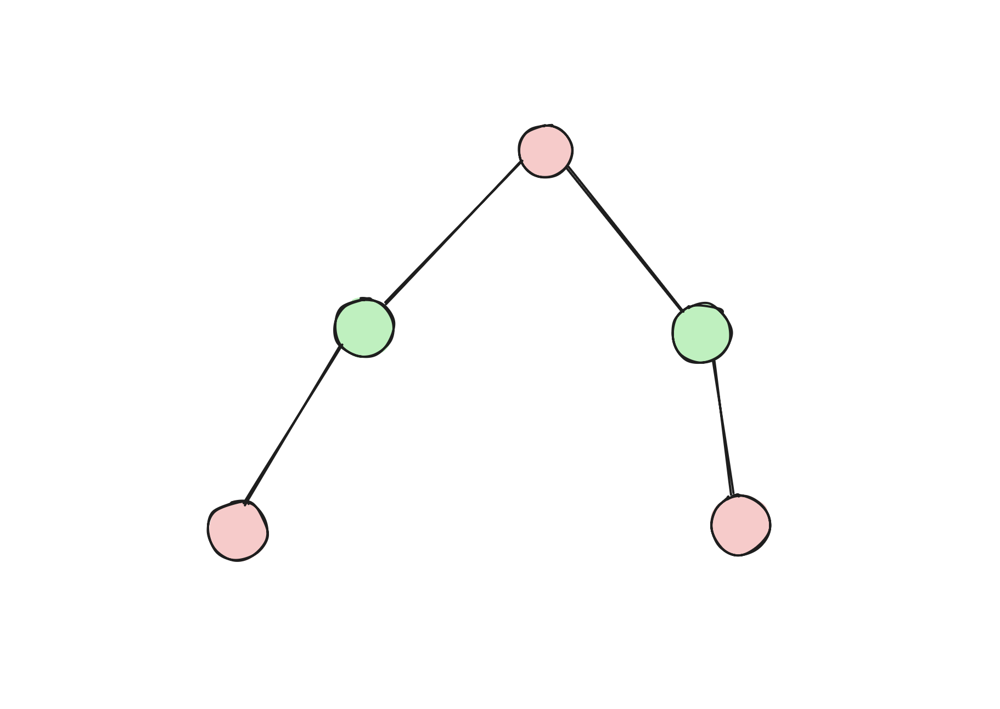
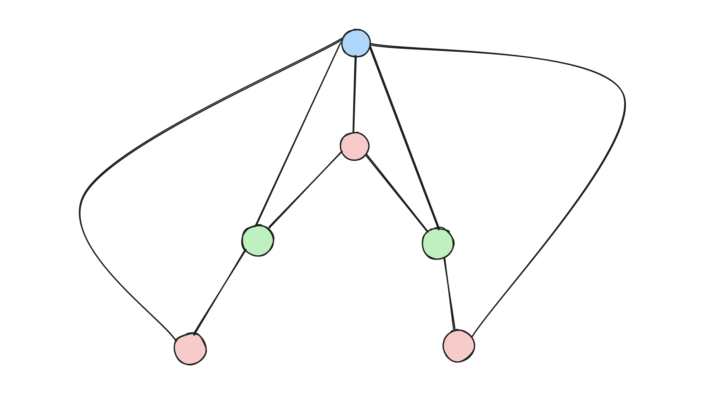

(★★) Definir los problemas de decisión de Grafo Bipartito y 3-Coloreo. Sabiendo que 3-Coloreo es NP-Completo, reducir Grafo Bipartito a 3-Coloreo. ¿Podemos afirmar que Grafo Bipartito es un problema NP-Completo?

Problema de decision de Grafo Bipartio: Existe un grafo G tal que ningun vertice comparta color con sus adyacentes, teniendo 2 colores.

Problema de decision de Grafo K-Coloreo: Existe un grafo G tal que ningun vertice comparta color con sus adyacentes, teniendo 3 colores.

# Demostracion

## Validador

Para afirmar que Grafo Bipartito esta en NP, primero hay que construir su validador

```python
def validador(colores, grafo):
    if len(colores) != len(grafo.obtener_vertices()):
        return False
    for v in grafo.obtener_vertices():
        if not in colores:
            return False
        for w in grafo.adyacentes(v):
            if colores[v] == colores[w]:
                return False
    return True
```
Este validador tiene una complejidad de O(V + E), ya que para cada vertice estoy viendo sus aristas y cada vez que me fijo si pertenece a colores, al ser colores un set, tiene un costo de O(1), por lo tanto este validador es polinomial, lo que quiere decir que bipartito esta en NP.

## Reduccion Propuesta

Para reducir grafo bipartito a 3 coloreo, propongo tener un grafo G' el cual es una copia de G, pero ademas tiene un nuevo vertice el cual esta conectado a todos los demas.

Ejemplo:

Grafo G


GrafoG'


## Existe Grafo Bipartito en G <-> Existe Grafo 3 coloreo en G'

### Existe Grafo Bipartito en G -> Existe Grafo 3 coloreo en G'

Al tener un grafo G el cual es bipartito, signfica que cada uno de sus vertices no comparte color con sus adyacentes, al ser G' una copia de G, eso significa que el grafo ya era bipartito y al sumarle un vertice v' de otro color conectado a los demas, al no compartir color con ninguno ahora tengo un grafo 3 coloreo.

### Existe Grafo Bipartito en G <- Existe Grafo 3 coloreo en G'

Al tener un grafo G' que cumple con ser 3 coloreo, cada vertice esta conectado con aquellos vertices que son de un color distinto (de entre 3 colores), por lo que al eliminar el vertice v', el cual es adyacente con todos los demas vertices, ahora todos los vertices van a cumplir con no compartir un mismo color, por lo que voy a tener un grafo bipartito.

# Conclusiones finales

Al haber reducido el grafo bipartito a 3-Coloreo, no signfica que bipartito este en NP-Completo, ya que para eso tendria que haber reducido un problema que este en NP-Completo a grafo bipartito.
