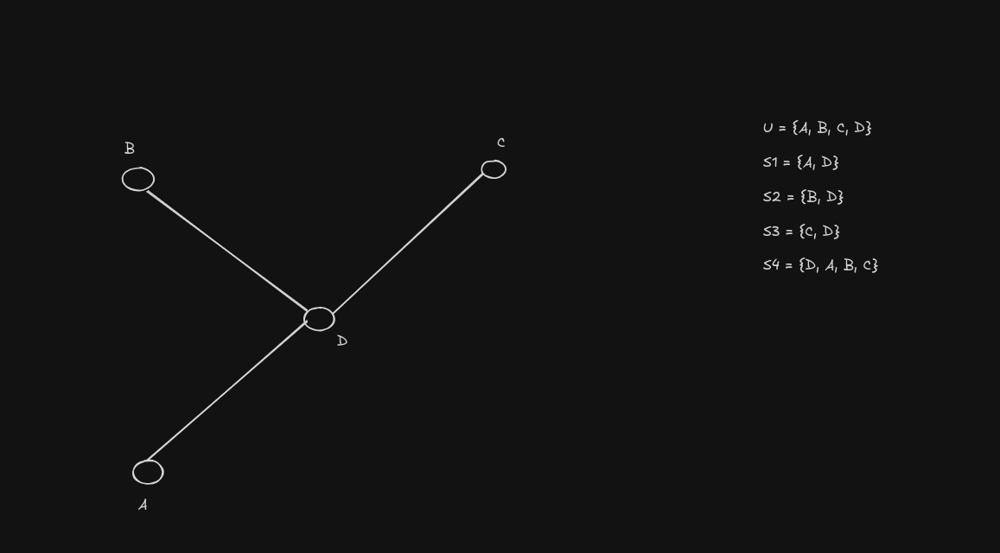

Demostrar que el problema de cobertura de conjuntos es NP-Completo.

# Demostracion

Para demostrar que el problema de covertura de conjuntos esta en NP-Completo, primero hay que demostrar que esta en NP.

Para eso construyo un validador polinomial

## Validador

```python
def validador(U, S, solucion, k):
  if len(solucion) > k:
    return False
  cubiertos = {}
  for subconjunto in solucion:
    if subconjunto not in S:
      return False
    for e in subconjunto:
      if e not in U:
        return False
      cubiertos.add(e)
  return cubiertos == U
  
```

La complejidad de este validador es O(n) siendo n la cantidad de elementos que hay en la solucion en cada uno de los subconjuntos, ya que
se recorren todos los subconjuntos de la solucion viendo cada uno de sus elementos y se verifica en cada uno de los conjuntos U y S si estan incluidos
lo cual es O(1) ya que son sets, por lo tanto, este es un validador polinomial valido, por lo que Set Cover esta en NP.

## Reduccion propuesta

La reduccion que propongo es reducir dominating set a set cover, para lograr esto, digo que tengo un grafo G el cual tiene una instancia de Dominating set
Donde cada vertice y cada uno de sus adyacentes que forman parte de D representan un conjunto.

ejemplo:



## Existe Dominating Set de como mucho K vertices <-> Existe Set Cover de como mucho K conjuntos

### Existe Dominating Set de como mucho K vertices -> Existe Set Cover de como mucho K conjuntos

Como tengo una instancia de Dominating Set en mi grafo G, eso quiere decir que si un vertice es parte del dominating set, todos sus adyacentes lo son, esos vertices que
forman parte de un dominating set, son un subconjunto del grafo, el cual dominan a todos los demas vertices del grafo, el cual es mi universo U, y cada uno de los vertices de este dominating set, es cada uno de los Si de mi set cover que me permiten cubrir todo el universo U.

### Existe Dominating Set de como mucho K vertices <- Existe Set Cover de como mucho K conjuntos

Al tener un Set Cover de K conjuntos, cada uno de esos conjuntos, son un vertice junto a cada uno de sus adyacentes en mi grafo original G, y al tener un set cover <= K, esos son los
vertices necesarios para dominar todo el grafo en mi grafo original G, logrando asi una instancia de Dominating Set.

# Conclusiones Finales

Como logre demostrar que Set Cover esta en NP, y logre reducir un problema que esta en NP-Completo a este ultimo, es que puedo decir que Set Cover esta en NP-Completo.
